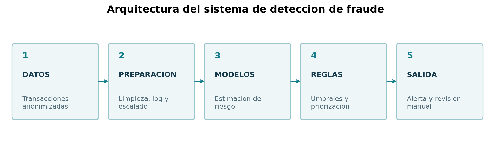

# Deteccion de fraude en pagos electronicos

Prueba de concepto (PoC) reproducible para detectar transacciones potencialmente fraudulentas con aprendizaje supervisado. Entrena y compara regresion logistica, Random Forest y un perceptron multicapa sobre el dataset publico **Credit Card Fraud Detection** de Machine Learning Group - ULB.

El sistema produce un **puntaje de riesgo no calibrado** y lo traduce a tres niveles operativos: alto (alerta prioritaria), medio (revision manual) y bajo (sin alerta). No se conecta a bancos, no procesa pagos reales y no debe utilizarse para bloquear operaciones.

## Objetivos y relacion con Inteligencia Artificial

La etiqueta historica `Class` permite formular el problema como clasificacion supervisada. Los modelos aprenden patrones multivariados; luego un motor de reglas representa conocimiento operativo al convertir el puntaje en una prioridad de revision. La PoC tambien puede entenderse como un agente de software: percibe una transaccion, la evalua y propone una accion. La supervision humana permanece dentro del circuito.

## Arquitectura



1. `data.py`: valida columnas, audita y elimina duplicados exactos.
2. `preprocessing.py`: aplica `log1p` a `Amount`, escala `Amount` y `Time`, y conserva V1-V28.
3. `training.py`: construye y entrena los tres pipelines.
4. `evaluation.py`: elige umbrales solo en validacion y calcula metricas.
5. `alerts.py`: calibra los niveles con una capacidad de revision cercana al 0,5 %.
6. `prediction.py`: reutiliza exactamente el pipeline entrenado para nuevos registros.

## Dataset

Fuente: [Credit Card Fraud Detection (Kaggle)](https://www.kaggle.com/datasets/mlg-ulb/creditcardfraud). Contiene 284.807 transacciones europeas registradas durante dos dias de septiembre de 2013, con 492 fraudes. `V1` a `V28` son componentes PCA anonimizados; `Time`, `Amount` y `Class` completan el esquema.

El CSV no se versiona. La descarga usa el endpoint publico de la API oficial de Kaggle:

```powershell
.\.venv\Scripts\python.exe scripts\download_data.py
```

La descarga publica suele funcionar sin credenciales. Si Kaggle exige autenticacion, defina `KAGGLE_USERNAME` y `KAGGLE_KEY` en el entorno tomando `.env.example` como referencia. Nunca confirme el token en Git.

Alternativa con la CLI oficial:

```powershell
kaggle datasets download -d mlg-ulb/creditcardfraud -p data/raw --unzip
```

## Instalacion

Requiere Python 3.11 o posterior. Se verifico con scikit-learn 1.7 o posterior.

### Windows PowerShell

```powershell
git clone https://github.com/Rem2207/deteccion-fraude-poc.git
Set-Location deteccion-fraude-poc
py -3.11 -m venv .venv
.\.venv\Scripts\python.exe -m pip install --upgrade pip
.\.venv\Scripts\python.exe -m pip install -r requirements.txt
```

### Linux/macOS

```bash
git clone https://github.com/Rem2207/deteccion-fraude-poc.git
cd deteccion-fraude-poc
python3.11 -m venv .venv
./.venv/bin/python -m pip install --upgrade pip
./.venv/bin/python -m pip install -r requirements.txt
```

## Ejecucion completa

```powershell
.\.venv\Scripts\python.exe scripts\download_data.py
.\.venv\Scripts\python.exe scripts\train.py
.\.venv\Scripts\python.exe scripts\evaluate.py
.\.venv\Scripts\python.exe -m pytest
```

El entrenamiento:

- elimina duplicados antes de separar datos;
- crea conjuntos estratificados 60/20/20 con semilla 42;
- ajusta todas las transformaciones solo con entrenamiento;
- usa pesos de clase para regresion logistica y Random Forest;
- usa `sample_weight` balanceado en MLP cuando la version instalada lo admite;
- elige el umbral de cada modelo maximizando F1 en validacion;
- selecciona el modelo por AP de validacion, con desempates documentados;
- utiliza prueba solo para la evaluacion final;
- ejecuta ademas una comprobacion temporal 80/20.

Para cambiar la cantidad de arboles o limitar paralelismo:

```powershell
.\.venv\Scripts\python.exe scripts\train.py --rf-estimators 300 --n-jobs 4
```

## Resultados reales

Los valores versionados en `reports/metrics/` se generan mediante el pipeline, nunca se escriben manualmente. Consulte:

- `metricas_validacion.csv`: seleccion de modelos y umbrales.
- `metricas_prueba.csv`: evaluacion final de los tres modelos.
- `metricas_temporales.json`: comprobacion sobre el 20 % final por `Time`.
- `alertas_prueba.csv`: operaciones, fraudes y alertas incorrectas por nivel.
- `comparacion_documento.md`: diferencias frente al trabajo academico.
- `metadata_ejecucion.json`: versiones y parametros de la corrida.

La ejecucion incluida se realizo con Python 3.11.9, scikit-learn 1.8.0, 300 arboles y semilla 42. La auditoria confirmo los numeros del documento: 284.807 filas originales, 1.081 duplicados exactos (19 fraudes), 283.726 filas limpias y 473 fraudes.

Resultados finales sobre 56.746 operaciones de prueba, con 95 fraudes:

| Modelo | AP | Precision | Recall | F1 | Accuracy | Umbral de validacion |
|---|---:|---:|---:|---:|---:|---:|
| Regresion logistica | 0,7253 | 0,8875 | 0,7474 | 0,8114 | 0,99942 | 1,0000* |
| Random Forest | **0,8525** | **0,9487** | 0,7789 | **0,8555** | **0,99956** | 0,2800 |
| Perceptron multicapa | 0,8291 | 0,7917 | **0,8000** | 0,7958 | 0,99931 | 0,9885* |

\* Los puntajes de regresion y MLP no estan calibrados. Los pesos de clase y la geometria del modelo pueden concentrarlos cerca de uno; los umbrales se eligieron por F1 en validacion y no deben interpretarse como probabilidades.

Random Forest se selecciono por su mayor AP en validacion (0,7953, frente a 0,7288 del MLP y 0,6993 de regresion). Su matriz final fue TN=56.647, FP=4, FN=21 y TP=74. Frente al documento, recupero un fraude adicional (74 en lugar de 73) y perdio uno menos (21 en lugar de 22); el umbral optimo fue 0,28 en vez de 0,37.

Los umbrales de alertas aprendidos en validacion fueron 0,28 para riesgo alto y 0,01333 para riesgo medio. En prueba quedaron 78 operaciones de riesgo alto (74 fraudes), 257 de riesgo medio (11 fraudes) y 56.411 de riesgo bajo (10 fraudes). Revisar alto + medio cubre 85 de 95 fraudes (89,47 %) mediante 335 revisiones (0,59 % del conjunto), con 250 alertas incorrectas.

En la comprobacion temporal, Random Forest obtuvo AP=0,8116, precision=0,9333, recall=0,7568 y F1=0,8358 sobre las 56.746 operaciones finales por `Time`. La caida respecto de la particion estratificada es coherente con un escenario mas exigente, aunque el dataset de solo dos dias impide estudiar deriva de largo plazo.

## Graficos

Todos se guardan como PNG a 220 dpi en `reports/figures/`:

1. distribucion de clases en escala logaritmica;
2. arquitectura del sistema;
3. curvas Precision-Recall de los tres modelos;
4. matriz de confusion del modelo seleccionado;
5. distribucion de alertas por nivel de riesgo.

## Probar nuevas transacciones

El CSV de entrada debe contener `Time`, `Amount` y `V1` a `V28`; no necesita `Class`.

```powershell
.\.venv\Scripts\python.exe scripts\predict.py nueva_transaccion.csv
```

Para guardar el resultado:

```powershell
.\.venv\Scripts\python.exe scripts\predict.py nueva_transaccion.csv --output predicciones.csv
```

Las columnas agregadas son `puntaje_riesgo`, `nivel_riesgo` y `requiere_revision`. El puntaje no se presenta como probabilidad porque no se evaluo su calibracion.

## Notebook

```powershell
.\.venv\Scripts\python.exe -m jupyter lab notebooks\01_analisis_entrenamiento.ipynb
```

El notebook importa los modulos del paquete. Para volver a entrenar desde el notebook, cambie `EJECUTAR_ENTRENAMIENTO` a `True`; por defecto muestra los resultados ya generados.

## Pruebas y calidad

```powershell
.\.venv\Scripts\python.exe -m pytest
```

Las pruebas unitarias cubren esquema, duplicados, particiones disjuntas, ajuste del escalador solo con entrenamiento, metricas, umbrales de riesgo y prediccion. Los datos sinteticos se usan unicamente en pruebas, nunca como evidencia de rendimiento. GitHub Actions ejecuta estas pruebas sin descargar el dataset completo.

## Estructura

```text
deteccion-fraude-poc/
|-- README.md
|-- REPRODUCIBILIDAD.md
|-- requirements.txt
|-- pyproject.toml
|-- data/
|-- notebooks/01_analisis_entrenamiento.ipynb
|-- src/fraud_detection/
|-- scripts/
|-- models/                  # artefactos locales, excluidos de Git
|-- reports/figures/
|-- reports/metrics/
|-- tests/
`-- .github/workflows/tests.yml
```

## Seguridad

`.gitignore` excluye dataset, modelos binarios, entornos virtuales, secretos, credenciales y temporales. Antes de cada publicacion se revisa el indice de Git. El repositorio no contiene numeros de tarjeta ni otras credenciales personales; el dataset esta anonimizado, pero se mantiene fuera del repositorio por licencia y tamano.

## Limitaciones

- El dataset tiene solo dos dias de 2013 y no permite medir deriva durante meses o anos.
- V1-V28 son anonimas; no permiten explicaciones comerciales por pais, dispositivo o comercio.
- Hay muy pocos fraudes, por lo que unos pocos casos cambian sensiblemente recall y precision.
- La particion temporal es una comprobacion limitada, no una validacion prospectiva real.
- No se evaluan latencia, deriva, calibracion, equidad, costos monetarios ni integracion productiva.
- Antes de produccion harian falta datos recientes, monitoreo, reentrenamiento, trazabilidad y revision humana.

## Posibles mejoras

Calibrar puntajes, estimar intervalos de confianza, incorporar costos distintos para FP/FN, evaluar gradient boosting, realizar validacion temporal por multiples ventanas, explicar predicciones y monitorizar deriva. Cualquier cambio debe conservar la separacion estricta entre entrenamiento, validacion y prueba.

## Referencias

- Dal Pozzolo, A. et al. (2014). *Learned lessons in credit card fraud detection from a practitioner perspective*. Expert Systems with Applications, 41(10), 4915-4928. <https://doi.org/10.1016/j.eswa.2014.02.026>
- Dal Pozzolo, A. et al. (2015). *Calibrating probability with undersampling for unbalanced classification*. IEEE SSCI. <https://doi.org/10.1109/SSCI.2015.33>
- Machine Learning Group - ULB. *Credit Card Fraud Detection*. <https://www.kaggle.com/datasets/mlg-ulb/creditcardfraud>
- scikit-learn. *Metrics and scoring*. <https://scikit-learn.org/stable/modules/model_evaluation.html>

Los pasos exactos para regenerar y actualizar el informe estan en [REPRODUCIBILIDAD.md](REPRODUCIBILIDAD.md).
